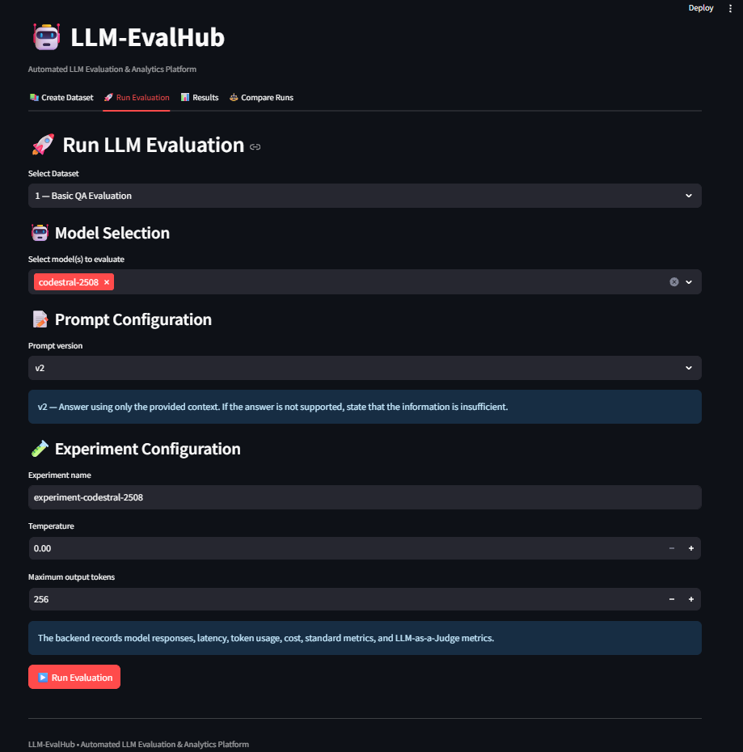
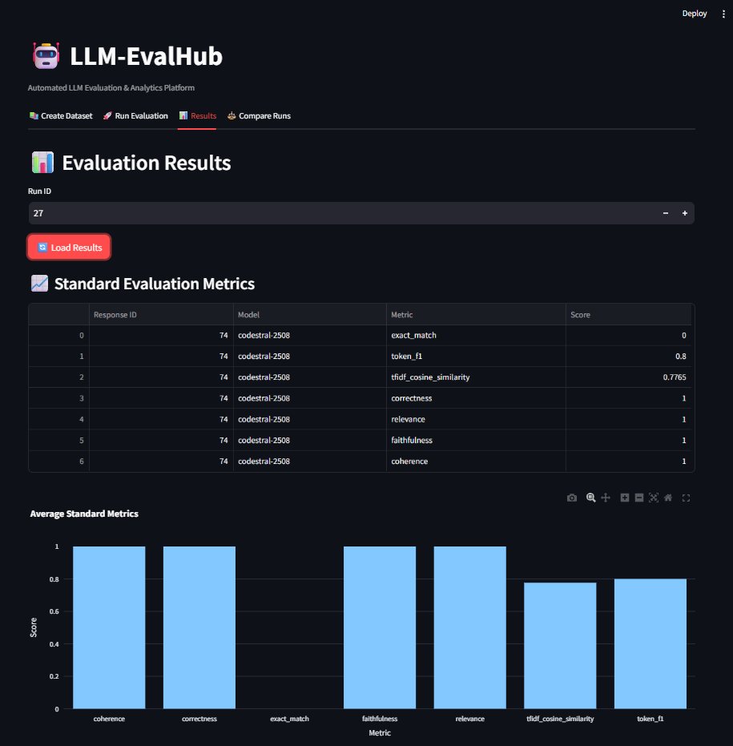
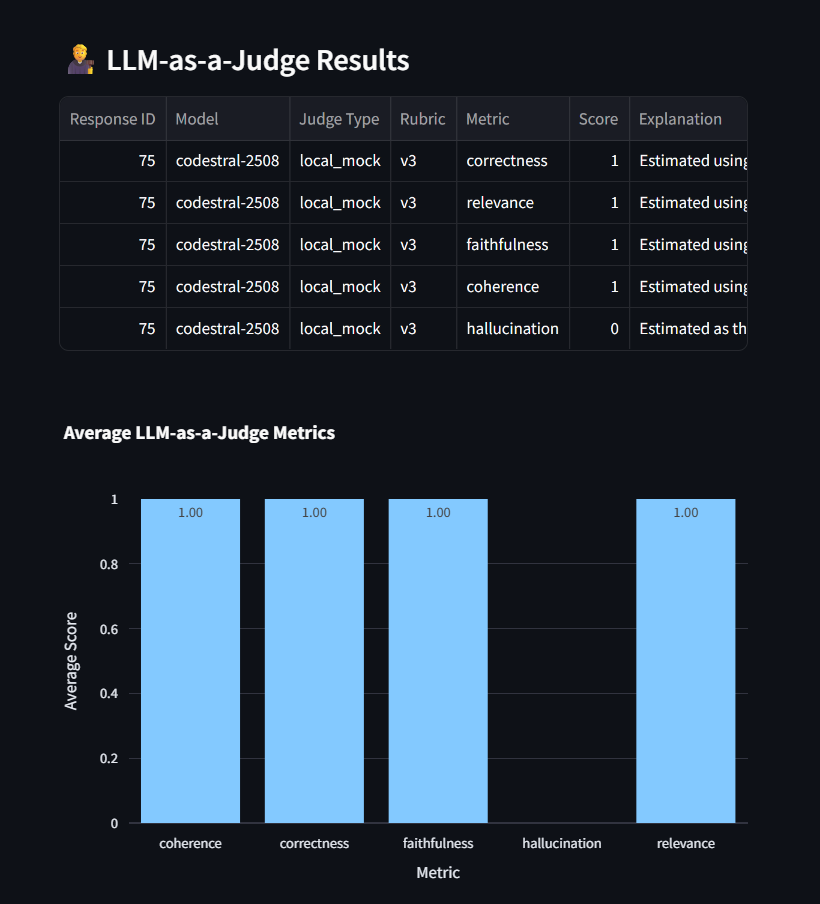
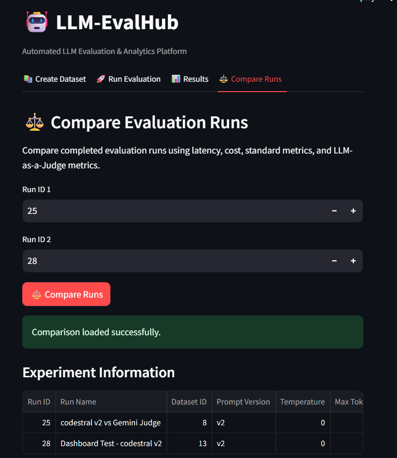

# LLM-EvalHub

LLM-EvalHub is a local evaluation dashboard for creating prompt datasets, running model responses, recording evaluation results, and comparing experiments. A FastAPI backend provides the API and persists data with SQLAlchemy and SQLite; a Streamlit application provides the user interface.

## Problem and objectives

Model outputs are difficult to compare consistently when prompts, datasets, response quality, latency, and estimated cost are not recorded together. This project provides a repeatable local workflow to:

- Store questions, optional context, and expected answers in datasets.
- Run supported language models against a versioned prompt.
- Record model outputs, request timing, token counts, estimated cost, and provider failures.
- Calculate seven local evaluation metrics and five judge metrics.
- Review and compare saved experiment runs in a dashboard.

## Implemented features

- Dataset creation and retrieval through the API and dashboard.
- Versioned prompt templates (`v1` and `v2`).
- Model clients for OpenAI, Google Gemini, and Mistral, plus a deterministic `mock-model` for local testing.
- Local metrics: exact match, token F1, TF-IDF cosine similarity, correctness, relevance, faithfulness, and coherence.
- Gemini LLM-as-a-Judge metrics: correctness, relevance, faithfulness, coherence, and hallucination. If the live judge cannot be used, the project records a deterministic local fallback instead.
- Persistent run, response, score, and judge-score records.
- Dashboard workflows for dataset creation, evaluation, result inspection, and run comparison.
- FastAPI's interactive Swagger documentation.

Local metric and fallback scores are heuristics; they should not be treated as a substitute for human review or as independent evidence of model quality.

## Technology

- Python, FastAPI, Uvicorn, Pydantic
- Streamlit, Pandas, Plotly
- SQLAlchemy and SQLite
- OpenAI Python SDK, Google GenAI SDK, Requests (Mistral API)
- Pytest

## Architecture

```text
Streamlit dashboard
        | HTTP (127.0.0.1:8001)
        v
FastAPI API ---- Prompt manager
        |
        +---- LLM clients (OpenAI / Gemini / Mistral / mock)
        +---- Local evaluator and Gemini judge / local fallback
        |
        v
SQLAlchemy ---- SQLite database
```

## Project structure

```text
LLM-EvalHub-Final/
|-- app/
|   |-- database.py
|   |-- evaluators.py
|   |-- llm_clients.py
|   |-- llm_judge.py
|   |-- main.py
|   |-- models.py
|   |-- prompt_manager.py
|   |-- schemas.py
|   `-- screenshots/
|-- prompts/
|   |-- v1.json
|   `-- v2.json
|-- tests/
|   |-- conftest.py
|   |-- test_api.py
|   |-- test_evaluators.py
|   |-- test_llm_clients.py
|   |-- test_llm_judge.py
|   `-- test_schemas.py
|-- .env.example
|-- .gitignore
|-- check_tables.py
|-- requirements.txt
|-- RUN_LLM_DASHBOARD.bat
`-- streamlit_app.py
```

## Prerequisites

- Windows 10 or later.
- Python 3.10 or later; the project environment was inspected with Python 3.12.
- Git is needed only to clone or contribute to the repository.
- Internet access and a provider API key are needed only for the selected live LLM integration. The local mock model and local evaluation tests do not require provider credentials.

## Windows setup (VS Code or PowerShell)

Open the project folder in VS Code. In a PowerShell terminal, use the actual project path:

```powershell
cd "C:\Users\pudar\OneDrive\Desktop\LLM-EvalHub-Final"
```

Create `.venv` only if it does not already exist, then install the dependencies:

```powershell
if (!(Test-Path ".\.venv\Scripts\python.exe")) {
    py -3 -m venv .venv
}
.\.venv\Scripts\python.exe -m pip install -r requirements.txt
```

If you want to activate the environment in the VS Code terminal:

```powershell
.\.venv\Scripts\Activate.ps1
```

If PowerShell blocks activation, either allow it for the current terminal with `Set-ExecutionPolicy -Scope Process Bypass`, or skip activation and use the explicit `.venv\Scripts\python.exe` commands below.

Create a local environment file if one is not present:

```powershell
if (!(Test-Path ".\.env")) {
    Copy-Item ".\.env.example" ".\.env"
}
```

Edit `.env` locally to add keys only for providers you intend to use. Do not commit this file. The mock provider can be used without any API key.

### Run in VS Code

Start the backend in **Terminal 1**:

```powershell
.\.venv\Scripts\python.exe -m uvicorn app.main:app --host 127.0.0.1 --port 8001 --reload
```

Start the dashboard in **Terminal 2**:

```powershell
.\.venv\Scripts\python.exe -m streamlit run .\streamlit_app.py --server.address 127.0.0.1 --server.port 8501
```

Open the dashboard at [http://localhost:8501](http://localhost:8501/). The backend is at [http://127.0.0.1:8001](http://127.0.0.1:8001/), and Swagger API documentation is at [http://127.0.0.1:8001/docs](http://127.0.0.1:8001/docs).

## Run both services with the Windows launcher

Double-click `RUN_LLM_DASHBOARD.bat` in File Explorer. It selects `.venv\Scripts\python.exe` relative to the batch file, checks required imports and ports, starts the backend, waits for its database-aware health endpoint, starts Streamlit, waits for its health endpoint, and then opens the dashboard. It reuses healthy existing services and reports occupied ports rather than launching over them.

If dependencies are missing, install them from PowerShell in the project folder:

```powershell
.\.venv\Scripts\python.exe -m pip install -r requirements.txt
```

The launcher does not delete or reset the SQLite database. On startup, SQLAlchemy creates tables that are missing from the configured database; it does not perform destructive schema migrations.

## Environment configuration

Copy `.env.example` to `.env`. The supported settings are:

| Variable | Required when | Description |
| --- | --- | --- |
| `DATABASE_URL` | Always has a default | SQLAlchemy connection URL. The default is `sqlite:///./eval_dashboard.db`, resolved from the working directory. |
| `OPENAI_API_KEY` | Using `gpt-4o-mini` | OpenAI API key. |
| `GOOGLE_API_KEY` or `GEMINI_API_KEY` | Using Gemini generation or a live Gemini judge | Google GenAI API key. |
| `MISTRAL_API_KEY` | Using `mistral-small-latest` or `codestral-2508` | Mistral API key. |
| `JUDGE_MODEL` | Optional | Gemini judge model; defaults to `gemini-3.6-flash`. |

Provider keys are not needed to run the backend, dashboard, or automated tests with `mock-model`. If no Google key is configured, the judge uses the local deterministic fallback. Live provider calls have not been verified as part of the local test suite.

## Database

The default database file is `eval_dashboard.db` in the project directory. The SQLAlchemy models define datasets, prompts, runs, responses, standard scores, and judge scores. Tables are initialized safely when the FastAPI application starts. Existing records are preserved; no database reset or destructive migration is performed.

Local database files and SQLite journal files are excluded by `.gitignore` because they may contain user or experiment data. Set `DATABASE_URL` in `.env` to use a different supported SQLAlchemy database URL.

## API overview

The interactive reference is available at `/docs` while the backend is running. Implemented routes include:

- `GET /` and `GET /health`
- `GET /prompts` and `GET /prompts/{version}`
- `GET /datasets`, `POST /datasets`, `GET /datasets/{dataset_id}/prompts`
- `POST /runs`, `GET /runs/{run_id}`
- `GET /runs/{run_id}/results`, `GET /runs/{run_id}/judge-results`
- `GET /compare?run_ids=1&run_ids=2`

`GET /health` executes a database query and returns a successful response only when the configured database can be reached.

## Tests

Run the suite using the project interpreter:

```powershell
.\.venv\Scripts\python.exe -m pytest -v
```

The API tests use an isolated temporary SQLite database and clear provider credentials for deterministic, offline testing; they do not write test datasets into the project's local database or call paid external APIs.

## Screenshots

The following existing dashboard screenshots are stored in [`app/screenshots/`](app/screenshots/):









## Troubleshooting and limitations

- **Virtual environment missing:** create `.venv` and install `requirements.txt` using the commands above.
- **Port 8001 or 8501 is occupied:** close the other service or identify the process using that port before starting the launcher.
- **Backend health check fails:** inspect the backend terminal for database configuration or startup errors. The launcher waits up to 30 seconds and does not open the dashboard on failure.
- **Provider reports a missing API key:** configure the relevant key in `.env`, or use `mock-model` for a local pipeline check.
- **Live calls are unavailable offline or without keys:** OpenAI, Google Gemini, and Mistral integrations require valid credentials and provider access. The local judge fallback is heuristic and is recorded as a fallback.
- The application is intended for local evaluation. It does not implement authentication or authorization.
- SQLAlchemy `create_all` creates missing tables but is not a schema migration system; schema changes to existing tables require a separately reviewed migration.

## Potential future work

Possible extensions include schema migrations, authentication, richer evaluation/report exports, additional judge providers, and deployment packaging. These are not represented as currently implemented features.

## Repository

Source repository: [Amarnath0720/LLM_Eval_hub](https://github.com/Amarnath0720/LLM_Eval_hub)
